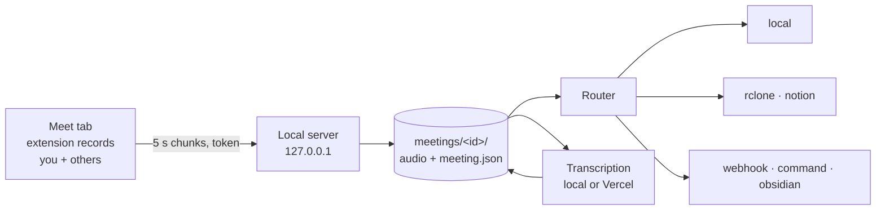

<div align="center">

# minuta

**Records your Google Meet calls from the browser, keeps them on your computer, and transcribes them when you ask.**


</div>

> [!IMPORTANT]
> **Consent.** Recording a call can require the consent of everyone in it, depending on where you
> and the other participants are. minuta does not tell anyone that you are recording: you are
> responsible for letting the other participants know and for following the law that applies to
> you.
>
> minuta is an independent open source project. It is not affiliated with, endorsed by or
> sponsored by Google. Google Meet is a trademark of Google LLC.

---

- **Only Google Meet, no bot.** A browser extension records the call from your own tab. Nobody
  joins the meeting and nothing is installed in Meet.
- **Respects the mute button.** Your voice is recorded only while Meet shows you unmuted. The file
  is stereo: left channel = you, right channel = everyone else.
- **Local first.** Each meeting is a folder on your computer. Nothing leaves it unless you add a
  destination that sends it somewhere.
- **Free local transcription,** or a paid API with your own key. Local runs faster-whisper (or
  mlx-whisper on Apple Silicon). The API option is Vercel AI Gateway, with a cost estimate, a
  spending cap and a confirmation before anything is sent.
- **Destinations you can combine:** a local folder, Google Drive, Dropbox, OneDrive or S3 through
  rclone, a Notion database, a signed webhook, a program of yours, or an Obsidian note.
- **One config file,** a setup assistant that writes it, and a command line for everything.

## Contents

- [Quick start](#quick-start)
- [Daily use](#daily-use)
- [Destinations](#destinations)
- [Transcription](#transcription)
- [Configuration](#configuration)
- [Update and uninstall](#update-and-uninstall)
- [Security and privacy](#security-and-privacy)
- [How it works](#how-it-works)
- [Known limits](#known-limits)
- [Troubleshooting](#troubleshooting)
- [Development](#development)
- [License](#license)

## Quick start

You need Chrome, Edge or Brave (desktop) and [ffmpeg](https://ffmpeg.org). Install ffmpeg first:
`brew install ffmpeg` (macOS), `sudo apt install ffmpeg` or `sudo dnf install ffmpeg` (Linux),
`winget install ffmpeg` (Windows). The installer warns if it is missing but does not install it.

**macOS and Linux:**

```bash
curl -fsSL https://raw.githubusercontent.com/damianpeaf/minuta/main/install.sh | sh
```

**Windows (PowerShell):**

```powershell
irm https://raw.githubusercontent.com/damianpeaf/minuta/main/install.ps1 | iex
```

### What the installer does

1. Installs [uv](https://docs.astral.sh/uv/) if it is not there.
2. Downloads minuta into your data folder (`.../minuta/app`, see [Configuration](#configuration)).
3. Installs the `minuta` command with `uv tool install`, with local transcription included and the
   dependency versions pinned in `uv.lock` (exported to `constraints.txt`). With an NVIDIA GPU
   (`nvidia-smi` found, Linux or Windows) it also adds the CUDA libraries.
4. Runs `minuta setup`.

Arguments after `sh -s --` (or after `install.ps1`) go to `minuta setup`. Environment variables
documented at the top of [`install.sh`](install.sh) and [`install.ps1`](install.ps1) change the
source, branch or tag (`MINUTA_REF`), folder, extras and Python version. The installer replaces the
source folder only if it is empty or was made by the installer.

### What `minuta setup` asks

| Step | Question | Default |
|---|---|---|
| 1 | Language of minuta's messages: English or Spanish | English |
| 2 | Your name, as it should appear in transcripts | your user name |
| 3 | Folder for recordings | the platform's data folder |
| 4 | Audio format: `opus` (as recorded, smallest) or `mp3` (re-encoded, plays everywhere) | `opus` |
| 5 | Also copy each meeting to another folder? Then, delete the local audio once the copy is confirmed? | no |
| 6 | Transcription engine: `local` (free) or `vercel` (paid; asks the model and your API key) | `local` |
| 7 | When to transcribe: on demand, or automatically after each call | on demand |
| 8 | Spending cap per transcription, in US$ (only for `vercel`) | 1.0 |
| 9 | Meeting language, like `en` or `es-419` (empty = detect) | detect |
| 10 | Send meetings anywhere else? One more destination, with its own questions | no |

Then it saves `config.toml`, installs the background service (systemd user unit on Linux, launchd
agent on macOS, a logon task on Windows), checks that the local server answers, opens your
browser's extensions page and prints the extension folder and a pairing code. It waits up to ten
minutes for the extension; Ctrl+C skips that step.

Every question has a flag, so the whole setup can run without questions (see `minuta setup --help`).
Destinations are added with `--destination TYPE[:NAME]`, each followed by its `--option key=value`; write `key@env=VAR` to read a secret from an environment variable instead of the command line,
the same options as [`minuta destinations add`](docs/destinations.md):

```bash
minuta setup --non-interactive --name Ana --engine local \
  --destination local --option copy_to=~/Dropbox/minuta \
  --destination webhook:n8n --option url=https://example.com/minuta --option signing_key@env=KEY
```

### Load the extension

The extension is not in the Chrome Web Store. Load it from the folder that setup prints:

1. Open `chrome://extensions`, `edge://extensions` or `brave://extensions`.
2. Turn on **Developer mode**.
3. Click **Load unpacked** and choose the folder setup printed. With the installer it is:
   - macOS: `~/Library/Application Support/minuta/app/extension`
   - Linux: `~/.local/share/minuta/app/extension`
   - Windows: `%LOCALAPPDATA%\minuta\app\extension`
4. Pin the minuta icon (puzzle-piece menu), click it and type the pairing code, like `482-913`.

The code is valid for 10 minutes and for 5 attempts. `minuta pair` prints a new one at any time.

### Check that it works

```bash
minuta status
```

```text
minuta 0.1.0
  config      /home/you/.config/minuta/config.toml
  data        /home/you/.local/share/minuta
  service     installed, active
  server      127.0.0.1:47321 answering
  extension   paired, last seen 4 s ago
  meetings    0 (0 without transcript, 0 with failed deliveries)
```

`minuta doctor` checks ffmpeg, the config, the data folder, the service, the server, the
extension, the browser, the secrets, the transcription engine and every destination, with a hint
for each problem.

## Daily use

**Join a Meet call.** About two seconds after you are in the call, the minuta icon turns red and
recording starts. You do not have to do anything.

**Leave the call.** A few seconds later the recording stops. The local server joins the audio,
checks that the other participants were captured, marks the meeting `ready` and hands it to your
destinations. In automatic mode it also transcribes it. If the tab closes without leaving the call,
the meeting is closed after 90 seconds without audio.

**The popup** (click the minuta icon) shows the state, the elapsed time and two level meters
(*You* and *Others*), and has these controls while recording:

| Button | What it does |
|---|---|
| Pause / Resume | Both channels are silent while paused. The meeting stays one file. |
| Finish | Stops recording this call and saves what was recorded. *Record this call* starts a new recording. |
| Don't record this call | Asks for confirmation, then deletes what was recorded and stops. Nothing is kept. |

The popup also shows the last meeting (saving, transcribed, or a warning) and the server port.
Serious problems also show as a browser notification: no microphone, Meet's mute button not found,
the others' voices not being recorded, or the minuta app not answering (the extension then keeps
up to about three hours of audio in memory until the app is back).

**The command line.** `minuta` with no arguments opens a menu. Every action is also a command:

```bash
minuta list                       # meetings, newest last, with failed deliveries (--all, --json)
minuta transcribe                 # pick a meeting from a list
minuta transcribe latest          # or an id, or the start of one
minuta transcribe latest --estimate          # only show what a paid engine would cost
minuta transcribe latest --from 10 --to 25   # only minutes 10 to 25
minuta transcribe latest --force             # transcribe again
minuta retry                      # send again what failed, or what a new destination never got
minuta doctor                     # what works and what does not
minuta pair                       # new pairing code (--rotate: new token, every browser pairs again)
minuta service restart            # also start, stop, status, install, uninstall
```

Each meeting is a folder in `<data>/meetings/<id>/`, where the id is the start time and the Meet
code, like `2026-03-02T15-30-00-000Z_abc-defg-hij`:

```text
meeting.json      title, Meet code and link, start, end, duration, audio check, delivery state
audio.opus        the recording (audio.mp3 with the mp3 format)
events.jsonl      mute and pause changes
transcript.md     } after transcribing
transcript.json   } turns with speaker, start, end and text
transcript.vtt    } subtitles
```

## Destinations

A destination receives each finished meeting and, later, its transcript. `local` is always there;
add as many others as you want. Full setup for each one: [docs/destinations.md](docs/destinations.md).

| Type | What it sends | What it needs | Can give the audio back |
|---|---|---|---|
| `local` | Keeps meetings in the data folder; with `copy_to`, also copies them to another folder (a Drive, Dropbox or iCloud synced folder works) | nothing | yes, with `copy_to` |
| `rclone` | One folder per meeting in Google Drive, Dropbox, OneDrive, S3, SFTP, WebDAV and about 70 more | [rclone](https://rclone.org) installed and a remote set up with it | yes |
| `notion` | One page per meeting in a database: properties, audio attached, transcript inside | a Notion internal integration and its secret | yes |
| `webhook` | Signed JSON (HMAC-SHA256) to a URL: n8n, Zapier, Make or your server. Audio only if you ask | an `https://` URL and a signing key | no |
| `command` | Runs a program of yours with the meeting folder, never through a shell | the program | no |
| `obsidian` | One Markdown note per meeting with frontmatter; your own notes in it are kept | the vault folder | no |

```bash
minuta destinations list
minuta destinations add drive --type rclone      # asks for what is missing
minuta destinations add notion
minuta destinations test drive
minuta destinations disable drive                # enable, remove (also deletes its secrets)
minuta retry                                     # send existing meetings to a new destination
```

The running service sees these changes on the next meeting; no restart is needed. A destination's
name is up to 32 lowercase letters, digits, `-` or `_`, starting with a letter.

**Deleting the local audio.** With `delete_local_audio_after_upload = true` under `[storage]`,
minuta deletes a meeting's local audio only when every enabled destination that receives audio
confirmed it holds a copy. It keeps the audio when the recording check found a problem, and in
automatic mode until the transcript exists. Destinations that can give the audio back (table
above) let `minuta transcribe` download it again later. A webhook never counts as holding the
audio. The setup assistant offers this after adding rclone or Notion, and then stops the `local`
destination from listing `audio` (it could not hold it once deleted).

**Writing a new destination** is one Python class and a test, inside minuta or as a separate
package with an entry point: [docs/destinations.md#writing-your-own](docs/destinations.md#writing-your-own).

## Transcription

| Engine | Cost | Runs on | Default model |
|---|---|---|---|
| `local` | free | Apple Silicon (mlx-whisper) | `large-v3-turbo` |
| `local` | free | NVIDIA GPU with CUDA (faster-whisper, float16) | `large-v3-turbo` |
| `local` | free | CPU (faster-whisper, int8) | `small` |
| `vercel` | per minute sent | [Vercel AI Gateway](https://vercel.com/ai-gateway), with your own key | `openai/whisper-1` |

The local model is downloaded the first time it is used. Choose another with
`[transcription.local] model` (`tiny`, `base`, `small`, `medium`, `large-v3`, `large-v3-turbo`).
On a CPU, larger models can take longer than the call itself.

**Each channel is transcribed on its own** (you on the left, the others on the right) and then
merged into turns. Only the stretches with speech are transcribed; text that Whisper is known to
invent over silence and repetition loops are removed.

**Vercel AI Gateway.** Setup offers `whisper` (`openai/whisper-1`), `gpt-4o-transcribe`, `grok` and
`gemini`. Before a paid run, minuta measures the speech that would be sent and prints an estimate;
it stops if the estimate is over the cap (`max_usd`, or `--max-usd`), and asks for confirmation
unless you pass `--yes`. Each request reserves its estimated cost before it leaves and is not sent
if it would pass the cap; the gateway's reported cost replaces the estimate. Only speech is sent,
so silence is not billed. In automatic mode there is no question: the cap is the only limit.

**Glossary and context** improve names and jargon:

```toml
[transcription]
language = "en"
context = "Weekly sync of the mobile team about the payments release."
glossary = ["Kubernetes", "Grafana", "OKR", "Priya", "Tomasz"]
```

For Whisper models both go into the prompt, which Whisper limits to about 224 tokens: keep the
context to one sentence in the meeting language and the glossary to 30 to 40 terms. The same
glossary goes to other providers in their own format. For a longer process (a glossary per
meeting, a dictionary of frequent errors, a correction pass) see the optional
[meeting-transcripts skill](skills/meeting-transcripts/SKILL.md).

## Configuration

`minuta setup` writes `config.toml`; you can edit it by hand and run setup again at any time.

| | Config (`config.toml`, `.env`, pairing) | Data (meetings, installed source) | Logs |
|---|---|---|---|
| macOS | `~/Library/Application Support/minuta` | `~/Library/Application Support/minuta` | `~/Library/Logs/minuta` |
| Linux | `~/.config/minuta` | `~/.local/share/minuta` | `~/.local/state/minuta/log` |
| Windows | `%APPDATA%\minuta` | `%LOCALAPPDATA%\minuta` | `%LOCALAPPDATA%\minuta\Logs` |

`MINUTA_HOME=/some/folder` puts config, data and logs under one folder.

```toml
[general]
language = "en"              # minuta's messages: en | es
data_dir = ""                # empty: the platform's data folder
audio_format = "opus"        # opus (as recorded) | mp3 (re-encoded, stereo kept)

[speakers]
me = "Ana"                   # left channel
others = "Others"            # right channel: everyone else, together

[server]
port = 47321                 # 127.0.0.1 only; change it in the extension popup too

[storage]
delete_local_audio_after_upload = false

[delivery]
max_attempts = 3             # per destination and step: waits 2 s, then 4 s (or what the remote asks)

[transcription]
mode = "on-demand"           # on-demand | auto
engine = "local"             # local | vercel
language = ""                # empty: detect. "en", "es-419"...
context = ""
glossary = []
max_usd = 1.0                # spending cap per run for vercel

[transcription.local]
model = "auto"               # auto | tiny | base | small | medium | large-v3 | large-v3-turbo
device = "auto"              # auto | cuda | cpu

[transcription.vercel]
model = "openai/whisper-1"

[secrets]
backend = "auto"             # auto: OS keyring, else .env | file: only .env

[destinations.local]
type = "local"
send = ["audio", "transcript", "metadata"]
# copy_to = "~/Dropbox/minuta"

[destinations.drive]
type = "rclone"
remote = "gdrive"
folder = "minuta"
```

**Secrets** (the Vercel key, a webhook signing key, the Notion token, an rclone config password)
never go in `config.toml`. They are stored in the OS keyring (Keychain, Credential Manager, Secret
Service) and `config.toml` keeps only their name, like `token_secret = "NOTION_TOKEN"`. Without a
usable keyring, or with `backend = "file"`, they go to `.env` in the config folder, readable only
by your user (0600). An environment variable with the same name always wins, for scripts and CI.

The background service reads `config.toml` again when it changes, before handling the next
meeting: destinations, transcription and storage settings need no restart. A new `port` or
`data_dir` does: `minuta service restart`.

## Update and uninstall

minuta **does not update itself**. To update:

```bash
minuta update
```

It gets the source again from the branch or tag you installed (`MINUTA_REF`, the default branch
when empty), reinstalls the command with the versions in `constraints.txt` and restarts the
service. Without git it downloads that branch or tag as an archive and replaces the source folder
in one step. A tag always gives the same version: to move to another one, run the installer again
with the new `MINUTA_REF`. Then open the extensions page, click the reload icon on the minuta card,
and reload any open Meet tab: a tab that was open before the extension reloaded is not recorded.

To uninstall:

```bash
minuta uninstall                        # asks; keeps your recordings unless you say otherwise
minuta uninstall --yes --no-delete-data # no questions, keep recordings and transcripts
minuta uninstall --yes --delete-data    # no questions, delete everything
```

It removes the background service, the configuration, the stored secrets, the logs and the
installed source, and runs `uv tool uninstall minuta`. On Windows the running `minuta.exe` cannot
delete itself, so that last step runs in the background a few seconds after the command ends. Then remove the extension from the extensions page. Copies already sent to destinations
are not touched.

## Security and privacy

- The local server listens only on `127.0.0.1`. It refuses requests whose `Host` is not
  `127.0.0.1` or `localhost` (DNS rebinding), and any browser `Origin` that is not a browser
  extension.
- The extension pairs with a one-time code shown in your terminal. Only its hash is stored, it
  expires in 10 minutes and allows 5 attempts. Pairing returns a random token that every request
  must carry; the extension's id is remembered and other extensions are refused.
- Secrets live in the OS keyring or a 0600 file, and are masked in every log. On macOS and Linux
  the config, data and meeting folders are readable only by your user (0700) and `config.toml` is
  0600.
- Nothing leaves your computer except what the destinations you enable send, and the audio sent to
  Vercel AI Gateway if you choose that engine. The local model is downloaded once from Hugging Face.
- `rclone` and `command` run programs with an argument list, never through a shell.

Threat model and how to report a vulnerability: [SECURITY.md](SECURITY.md).

## How it works



1. The extension's page script hooks Meet's audio: your microphone through a gain that is open only
   while Meet shows you unmuted, and what Meet plays to your speakers for everyone else. It records
   them as one stereo stream and sends a chunk every 5 seconds to the local server, with a
   heartbeat that feeds the warnings.
2. When the call ends, the server joins the chunks into `audio.opus` (no re-encoding) or
   `audio.mp3`, checks that the others' channel has sound when other participants were present,
   and marks the meeting `ready`.
3. The router sends the meeting to every enabled destination, records each outcome in
   `meeting.json`, retries with backoff (or the wait the remote side asks for), and never sends a
   step that already succeeded.
4. A transcript (automatic mode or `minuta transcribe`) is written as `.json`, `.md` and `.vtt` and
   sent to the destinations that take transcripts.

More detail: [docs/architecture.md](docs/architecture.md).

## Known limits

- **Only Google Meet,** in the browser tab. Not the Meet mobile apps, and not other meeting tools.
- **Only Chromium browsers on desktop:** Chrome, Edge and Brave (version 116 or later). Not
  Firefox or Safari.
- **The others are one channel.** Everyone except you is labelled `Others`; minuta does not tell
  the other participants apart.
- **Meet changes.** minuta finds the mute button and the call state in Meet's page. A change in
  Meet can break that until minuta is updated; the popup and a notification say so when it
  happens.
- **After reloading the extension, reload the Meet tab.** The page script is attached when the tab
  loads.
- **Notion's free plan** takes files up to 5 MB, about ten minutes of audio at the extension's 64 kbps. Use a paid
  plan or send only `metadata,transcript` to Notion.
- **Updates are manual** (`minuta update`), and the extension is loaded unpacked, outside any store.

## Troubleshooting

| Symptom | Try |
|---|---|
| The popup says *minuta is not answering* | `minuta status`, then `minuta service restart`. Check that the port in the popup matches `[server] port`. |
| The popup asks for a pairing code | `minuta pair` and type the new code. |
| Nothing is recorded when I join | Reload the Meet tab (always after reloading the extension). |
| *Cannot find Meet's microphone button* | Your voice is not being recorded. Reload the tab; if it persists, Meet changed: open an issue. |
| A new destination never receives older meetings | `minuta retry` sends them. |
| A delivery failed | `minuta list` shows it, `minuta destinations test NAME` explains it, `minuta retry` sends it again. |
| Local transcription is slow | Use a smaller model, or the `cuda` extra on an NVIDIA GPU. |

More cases and where the logs are: [docs/troubleshooting.md](docs/troubleshooting.md).

## Development

```bash
git clone https://github.com/damianpeaf/minuta && cd minuta
uv sync --extra local
uv run ruff check
uv run pytest                                    # fast tests: no browser, no real service
```

Slower tests are behind markers and do not run by default:

| Marker | What it needs | Command |
|---|---|---|
| `browser` | Playwright Chromium (`uv run playwright install chromium`) | `uv run pytest -m "browser and not slow"` |
| `slow` | downloads a real model | `uv run pytest -m slow tests/test_local_transcription_real.py` |
| `service` | installs a real background service for your user | `uv run pytest -m service` |
| `rclone_live` | rclone and Docker (a folder, SFTP and S3) | `uv run pytest -m rclone_live` |
| `notion_live` | `MINUTA_TEST_NOTION_TOKEN` and `MINUTA_TEST_NOTION_PARENT` (a page or database); works inside one temporary page that is trashed at the end | `uv run pytest -m notion_live` |

To try the extension from a checkout, load the repository's `extension/` folder unpacked and run
`uv run minuta serve` in a terminal. How to contribute: [CONTRIBUTING.md](CONTRIBUTING.md).

## License

[MIT](LICENSE).

Ideas and pull requests are welcome: [CONTRIBUTING](CONTRIBUTING.md) · [Code of Conduct](CODE_OF_CONDUCT.md) · [Security](SECURITY.md).
