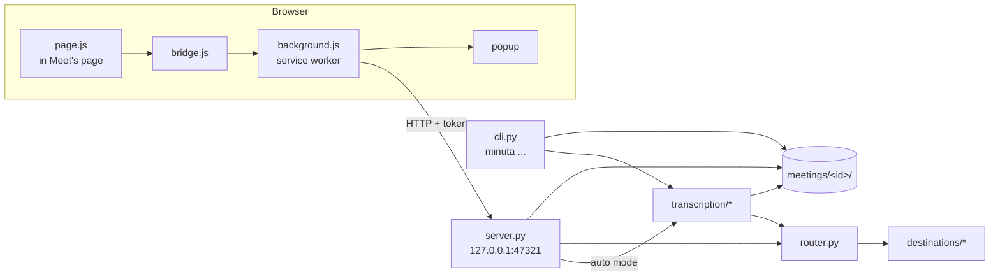

# Architecture

minuta has two halves that talk over `127.0.0.1`: a browser extension that records, and a Python
program that stores, delivers and transcribes.

## The extension (`extension/`)

| File | Role |
|---|---|
| `page.js` | Runs in Meet's own page (`world: MAIN`) before Meet's scripts. Hooks the Web Audio and WebRTC objects Meet creates, finds your microphone and what Meet sends to your speakers, and records both into one stereo `MediaRecorder` stream (Opus, 64 kbps): left = you, right = everyone else. Your channel goes through a gain that opens only while Meet's mute button says you are unmuted. Starts after about 2 s in a call, stops about 6 s after leaving. Sends a chunk every 5 s and a heartbeat with its state. |
| `bridge.js` | A content script that relays messages between the page and the service worker. |
| `background.js` | The service worker. Owns the pairing token and the port, posts chunks to the local server, keeps up to about three hours of chunks in memory while the server does not answer, paints the toolbar icon, shows notifications for serious problems and feeds the popup. |
| `popup.*` | State, level meters, pause, finish, discard, pairing and the port. Keeps no state of its own. |

## The local server (`src/minuta/server.py`)

A `ThreadingHTTPServer` bound to `127.0.0.1`, started by the background service (`minuta serve`).

- Every request is checked for `Host` (`127.0.0.1:<port>` or `localhost:<port>`) and, when an
  `Origin` is present, that it is a paired browser extension. Everything except `/health` and
  `/pair` needs the `X-Minuta-Token` header. See [`pairing.py`](../src/minuta/pairing.py).
- `/start`, `/chunk`, `/title`, `/mute`, `/pause`, `/end` and `/discard` drive one recording.
  Chunks are written to `meetings/<id>/chunks/`. A body needs a `Content-Length` (at most 20 MB, 1 KB
  for `/pair`), a client has 15 s to send its request, and the text fields of `/start` are cut to
  200 characters (`startedAt` must be an ISO 8601 time, or the server's clock is used).
- A watchdog closes a recording after 90 seconds without audio, for a tab
  that closed without leaving the call. At startup, recordings in progress are watched again and
  queued meetings go back to the queue, so a restart mid-call keeps the recording.
- A worker thread finishes each meeting: joins the chunks ([`audio.py`](../src/minuta/audio.py)),
  remuxes to `audio.opus` without re-encoding (or encodes `audio.mp3`), checks that the others'
  channel has sound when other participants were seen, marks it `ready`, hands it to the router,
  transcribes it in automatic mode, and applies the audio deletion policy.

The server reads `config.toml` at start and again whenever the file changes, before finishing the
next meeting, so `minuta destinations add` and edits by hand need no restart (the port and the
data folder do).

## Meetings (`src/minuta/meetings.py`)

One folder per meeting under `<data>/meetings/<id>/`. `meeting.json` holds the metadata, the
status (`recording`, `queued`, `processing`, `ready`, `error`, `discarded`), the audio check and the
state of every delivery. Writes go through a temporary file and a rename. On macOS and Linux the
data, meetings and meeting folders are 0700.

## Delivery (`src/minuta/router.py`, `src/minuta/destinations/`)

The router sends two steps per destination: `meeting` (when the meeting is ready) and `transcript`
(when one exists). Each outcome is stored in `meeting.json` under `destinations.<name>.<step>`.
The router is the only place that retries: up to `[delivery] max_attempts`, waiting 2 s, then
4 s, or what the remote side asked for with `Retry-After` (a wait over a minute is left to
`minuta retry`). A step already `ok` is never sent again, and a failing destination never stops the
others. `minuta retry` sends again what failed and anything for a destination added later.

Destinations are classes registered by type through the `minuta.destinations` entry point group;
the built-in ones are declared in `pyproject.toml`, and a plugin cannot replace one of them. The interface and the rules are in [destinations.md](destinations.md#writing-your-own).

## Transcription (`src/minuta/transcription/`)

| File | Role |
|---|---|
| `pipeline.py` | Splits the two channels, finds the stretches with speech, sends them to the engine, drops invented text, loops and prompt echoes, optionally re-runs phrases that came out in the wrong language, and merges both channels into turns. |
| `local.py` | mlx-whisper on Apple Silicon; faster-whisper elsewhere, on CUDA when cuBLAS loads and on the CPU with int8 otherwise. |
| `vercel.py` | Vercel AI Gateway's transcription route, with the provider options each model expects (language, prompt, glossary). |
| `common.py` | Batching: only speech is sent to paid engines, glued with 1 s of silence, and times are mapped back. |
| `budget.py` | The spending cap: each request reserves its estimated cost before it leaves. |
| `export.py` | `transcript.json` to `.md` and `.vtt` (the obsidian destination reuses its Markdown). |

## The command line and the service

[`actions.py`](../src/minuta/actions.py) is what each command does, as data (status, meetings,
destinations, engines with their estimates, transcribe and retry with an `on_progress(step, fraction,
info)` callback): nothing there prints or translates, so the server can offer the same actions to
the extension. [`cli.py`](../src/minuta/cli.py) is the `minuta` command and its menu: it asks with
questionary, prints with [`ui.py`](../src/minuta/ui.py) (rich tables, a spinner per step, progress
bars) and translates with [`i18n.py`](../src/minuta/i18n.py); logs go to `cli.log`, not the
terminal. [`setup.py`](../src/minuta/setup.py) is the assistant; [`service.py`](../src/minuta/service.py) installs `minuta serve` as a systemd user
unit (Linux), a launchd agent (macOS, `io.minuta.server`) or a logon task in Task Scheduler
(Windows, with a per-user `Run` registry entry as fallback).
[`credentials.py`](../src/minuta/credentials.py) stores secrets in the OS keyring or a 0600 `.env`,
and [`redact.py`](../src/minuta/redact.py) masks them in logs.
